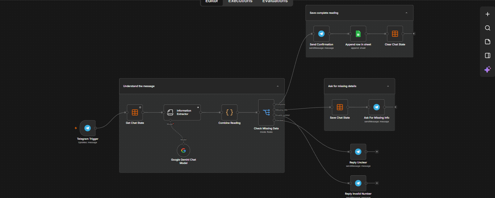
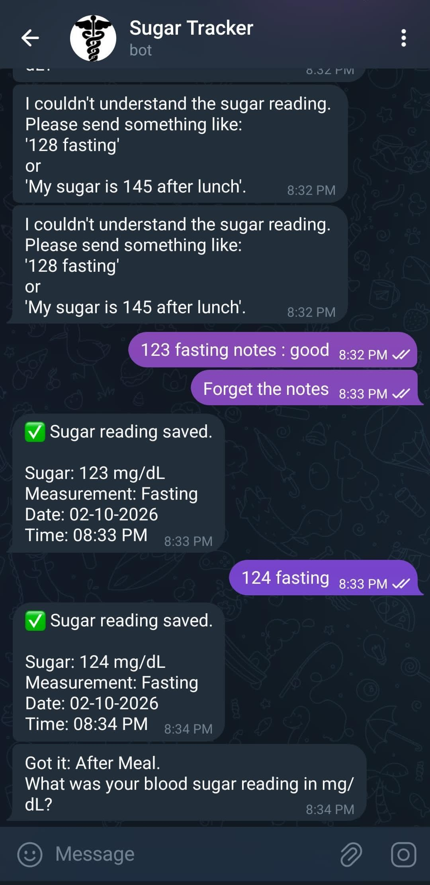
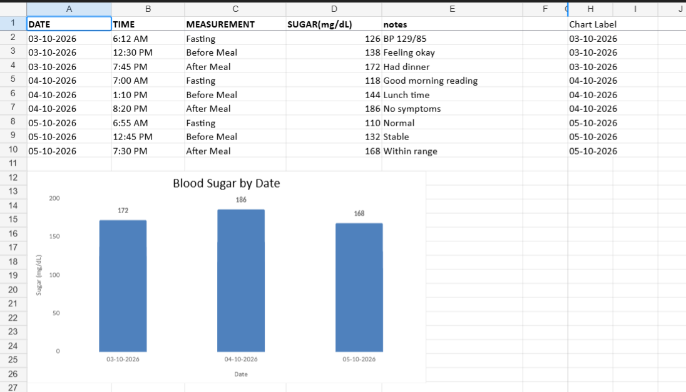

# n8n Diabetes Sugar Tracker

<p align="center">
  
</p>

<p align="center">
  
  
  
  
</p>

An intelligent Telegram bot built with n8n to help diabetic patients log blood sugar readings in natural language and save them to Google Sheets.

## Overview

This workflow listens for Telegram messages, extracts blood sugar values and measurement context using AI, asks for missing information when needed, and stores valid entries in a spreadsheet for easy tracking.

It is designed for quick daily logging like:

- "128 fasting"
- "My sugar is 145 before lunch"
- "185 after dinner"
- "Checking in: 110 random"

## Features

- Telegram message trigger for sugar logging
- AI-powered extraction of:
  - sugar value
  - measurement type
  - notes
  - date/time if mentioned
- Conversation state tracking to handle follow-up questions
- Validation for invalid or unclear readings
- Automatic storage in Google Sheets
- Sample CSV data included for testing and demo purposes

## Workflow Highlights

The workflow does the following:

1. Receives a message from Telegram.
2. Reads any saved chat state for that user.
3. Uses an AI information extractor to parse the message.
4. Combines extracted data with prior state.
5. Checks whether the reading is complete, missing data, unclear, or invalid.
6. Asks the user for missing values when required.
7. Saves valid readings to a Google Sheet.
8. Clears the temporary chat state after a successful save.

## Project Structure

- `workflow/sugarTracker_bot.json` - n8n workflow export
- `sample-data/sample-sugar-data.csv` - sample blood sugar readings
- `screenshots/` - workflow and output images

## Sample Data

The repository includes sample readings such as:

```csv
DATE,TIME,MEASUREMENT,SUGAR(mg/dL),notes
03-10-2026,6:12 AM,Fasting,126,BP 129/85
03-10-2026,12:30 PM,Before Meal,138,Feeling okay
03-10-2026,7:45 PM,After Meal,172,Had dinner
```

## Screenshots

### Telegram bot interaction

<p align="center">
  
</p>

### Google Sheet output

<p align="center">
  
</p>

### Workflow view

<p align="center">
  
</p>

## How it Works

The bot stores a temporary state per chat so it can ask follow-up questions when a message is incomplete. For example:

- If a user sends just `145`, the bot asks: "Was this fasting, before meal, after meal, or random?"
- If a user sends `after lunch`, the bot asks for the blood sugar number.
- If the value is clearly invalid, the bot prompts the user to resend it.

This makes the bot feel conversational while still keeping the final log structured.

## Getting Started

1. Import the workflow from `workflow/sugarTracker_bot.json` into n8n.
2. Configure the Telegram node with your bot token.
3. Connect a Google Sheets credential and select the target spreadsheet.
4. Configure the n8n Data Table to persist per-chat state.
5. Add your preferred AI model (for example Google Gemini) using the relevant LangChain node.
6. Start the workflow and send a message to your Telegram bot.

## Notes

- This project is intended for personal health tracking assistance.
- The workflow is a sample automation and should be reviewed before using it in a clinical or production setting.
- Data privacy and storage should be considered when handling health information.

## License

This project is provided for educational and personal use.

